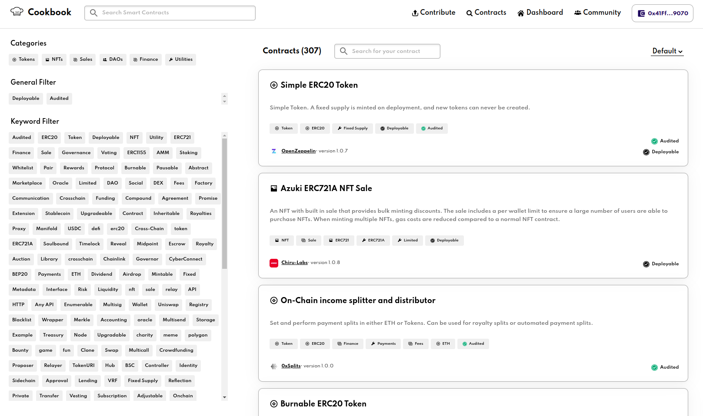
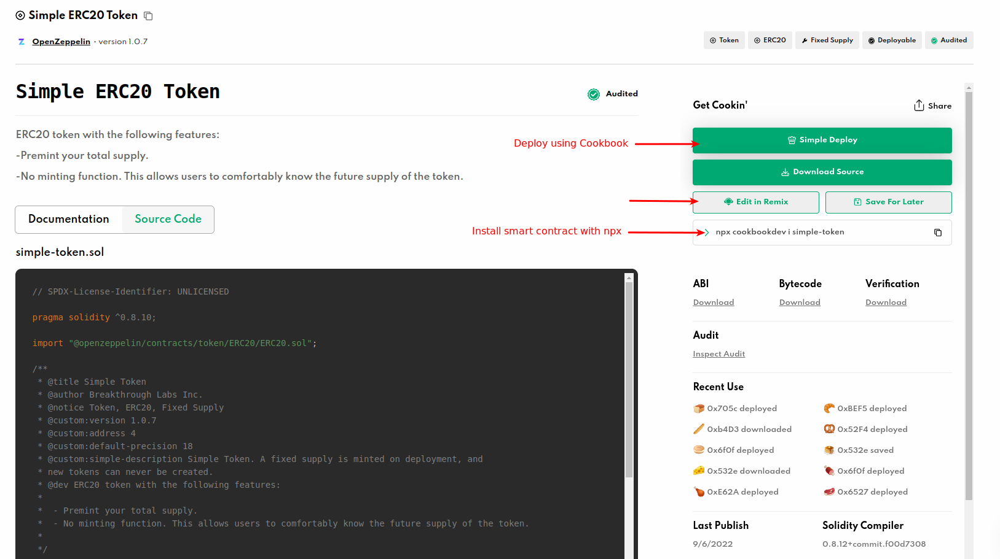
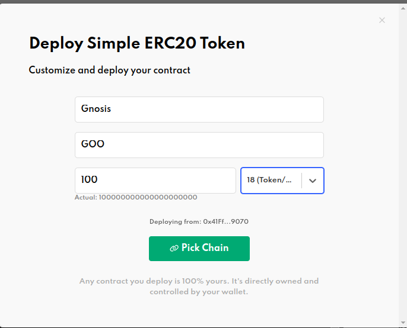
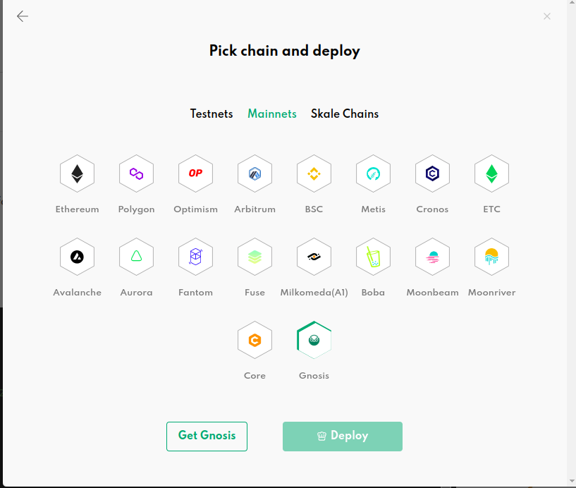
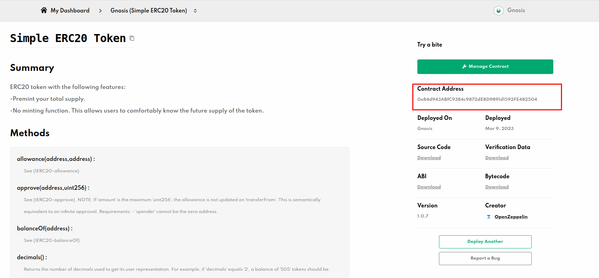

# Using Cookbook (Archived)

:::danger Archived
Cookbook is **no longer a supported way to deploy contracts on Gnosis Chain**. cookbook.dev has gone offline (as of October 2026 the domain no longer resolves), so the marketplace, the deploy flow and the links on this page no longer work. To deploy contracts on Gnosis, use [Hardhat](../../docs/developers/dev-environment/hardhat.md) or [Foundry](../../docs/developers/dev-environment/foundry.md).

This page is kept for historical reference only and is not published on [docs.gnosischain.com](https://docs.gnosischain.com).
:::

Cookbook was an open source smart contract marketplace. You could search, upload, download, deploy, manage and integrate any Solidity smart contract into your app.

It supported Gnosis Chain and Chiado.

## Search on smart contract marketplace
Navigate to [Cookbook](https://www.cookbook.dev/search?q=), and search for the smart contract you would like to use or deploy: 

## Choose the deploy option
Once you've chosen your smart contract, you have different options to select:
1. Simply Deploy: Configure and Deploy the smart contract on the network you chose by few clicks.
2. Edit On Remix: Use [Remix IDE](https://remix.ethereum.org/) to edit the smart contract
3. Download smart contract: Download the smart contract and use it locally.

In this tutorial, we'll choose **Simply Deploy** option.

## Configure the smart contract

## Pick a chain
Select the network for which the smart contract to be deployed to.
Click **Deploy** and you'll be prompted to sign a smart contract creation transaction. Please check that whether you have enough xDAI balance on your wallet.

## Check your deployed smart contract on Dashboard
Once the smart contract is deployed, you may check the address on Dashboard. You may also download ABI, Bytecode, Source Code and Verification Data from here.

## Additional Resources
* [Cookbook](https://www.cookbook.dev/)